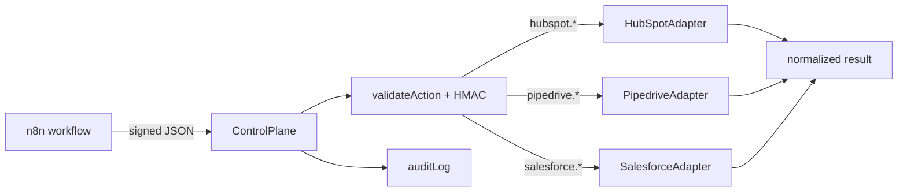

# n8n-crm-control-plane

TypeScript library that verifies HMAC-signed inbound actions from n8n (or any webhook caller) and routes them to HubSpot, Pipedrive, or Salesforce adapters with a small audit trail.

## What it is for

- **Signed webhooks** — HMAC-SHA256 over `{ type, payload, timestamp, nonce }`
- **Validated actions** — typed allowlist of CRM operations, no extra schema dependencies
- **Adapter layer** — HubSpot, Pipedrive, and Salesforce REST stubs with injectable `fetch`
- **Audit hooks** — append success/failure entries for debugging and compliance drafts

## Demo

```ts
import { signAction, ControlPlane } from 'n8n-crm-control-plane';

const secret = process.env.CONTROL_PLANE_SECRET!;
const type = 'hubspot.createContact';
const payload = { email: 'demo@example.com', firstName: 'Demo' };
const timestamp = Date.now();
const nonce = crypto.randomUUID();
const signature = signAction(secret, type, payload, timestamp, nonce);

const auditLog = [];
const plane = new ControlPlane({
  secret,
  auditLog,
  hubspot: { accessToken: process.env.HUBSPOT_TOKEN! },
});

const result = await plane.handleInboundAction({
  type,
  payload,
  timestamp,
  nonce,
  signature,
});
```

## Quick start

```bash
npm install
npm run verify
```

Emitted JavaScript:

```bash
npm run build
```

Or:

```bash
make verify
```

## Architecture



## Supported actions

| Action type | Adapter method |
|-------------|----------------|
| `hubspot.createContact` | Create contact with mapped properties |
| `hubspot.updateDeal` | Patch deal by `dealId` |
| `pipedrive.createContact` | Create person |
| `pipedrive.updateDeal` | Update deal |
| `salesforce.createContact` | REST create Contact |
| `salesforce.updateDeal` | REST patch Opportunity |

## Decisions and tradeoffs

| Choice | Why | Cost |
|--------|-----|------|
| JSON canonical signing | Easy to reproduce in n8n Code node | Payload key order must match `JSON.stringify` semantics |
| Timestamp window | Limits replay window | Callers need reasonable clock sync |
| Injectable `fetch` | Tests without network | Production still needs retries and rate limits |
| In-memory audit log | Simple hook for demos | Persist externally for production |

## Security notes

- Use a dedicated webhook secret; rotate on compromise.
- Default validation rejects stale timestamps (5 minutes) and far-future skew.
- Signatures use constant-time comparison on hex digests.

## Tests

```bash
npm test
```

Vitest covers valid/invalid HMAC, unknown action types, HubSpot field mapping, and audit log success/failure.

## License

MIT — see [LICENSE](LICENSE).

## Hire note

If you are hiring for n8n integrations, CRM webhooks, or TypeScript control planes and want libraries that ship with tests and CI, reach out via the GitHub profile linked from this repository.
